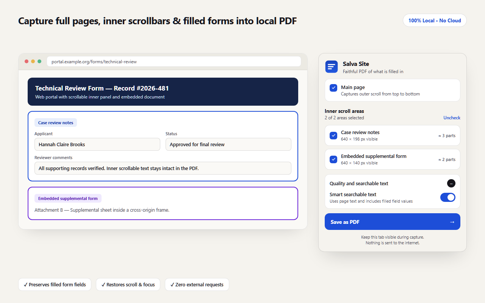
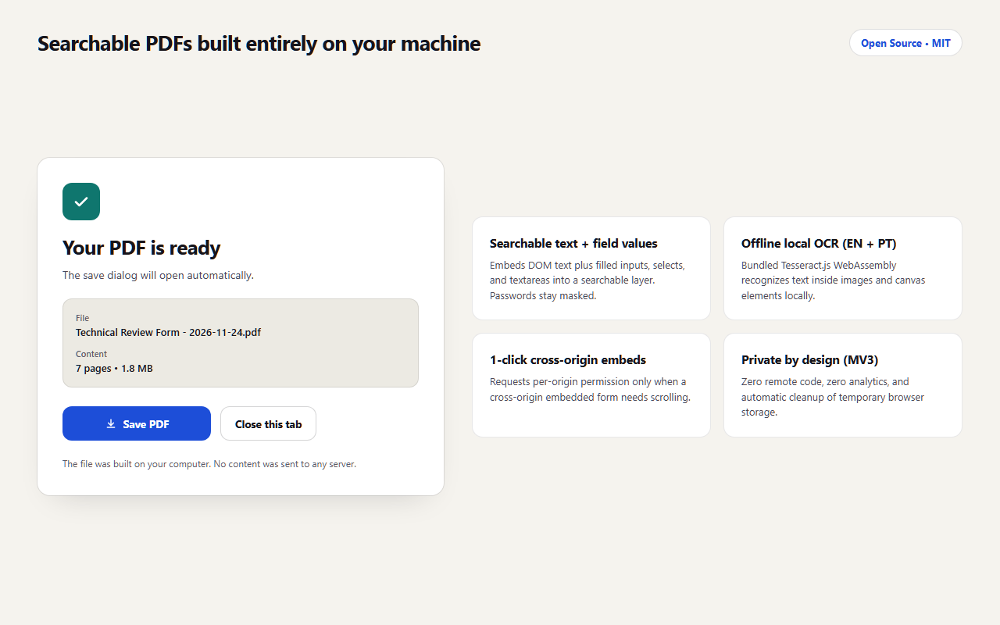

**English** | [Português (Brasil)](README.pt-BR.md)

# Salva Site

[](LICENSE)
[](src/manifest.json)
[](PRIVACY.md)
[](https://github.com/ricarossetto/salva-site/actions/workflows/ci.yml)

Capture full web pages, inner scrollable panels, embedded cross-origin forms, and filled form inputs into **searchable, locally built PDFs** — without reloading the page or sending data to any server.

---

## Why Salva Site?

Standard browser Print-to-PDF and typical full-page screenshot extensions break down on complex portals and web apps:

- **Inner scrollbars get cut off** (tall cards, side panels, `<textarea>` blocks, scrollable tables).
- **Embedded forms in `<embed>` or `<iframe>` elements are truncated** at their visible frame box.
- **Page reloads wipe filled inputs**, losing unsaved form entries before saving.
- **Plain image captures are not searchable** unless you run local text extraction or OCR.

Salva Site reads the live visible page directly in your browser tab, steps through both outer and inner scroll areas without reloading, restores your exact scroll position and focus afterward, and assembles a multi-page searchable PDF entirely on your machine.

---

## Screenshots





---

## Features

- **Main page + inner scroll detection:** Automatically finds scrollable panels (`overflow-y: auto|scroll|overlay`, `<textarea>`) and lets you choose which areas to include with live page highlighting on hover/focus.
- **Generic embedded form support (`<embed>` & `<iframe>`):** Captures same-origin frames automatically and detects cross-origin embedded documents with a **1-click per-origin permission prompt** — zero broad host permissions requested on install.
- **Preserves filled form state:** Captures `<input>`, `<select>`, `<textarea>`, checkboxes, and radio values exactly as currently filled in.
- **Smart searchable PDF layer:** Embeds DOM text and visible form field values into an invisible searchable layer using bundled `pdf-lib`, `@pdf-lib/fontkit`, and `Noto Sans`.
- **Optional offline OCR (English + Portuguese):** Bundled `tesseract.js` WebAssembly engine extracts text from images and `<canvas>` elements completely offline.
- **Cancel anytime & non-destructive:** In-page status card shows real progress and lets you cancel mid-capture (or press `Esc`), always restoring original scroll offsets and active element focus.
- **Adaptive Light & Dark UI:** Built with warm paper/carbon-ink contrast (`prefers-color-scheme`), keyboard navigation, screen-reader labels, and `prefers-reduced-motion` support.
- **Multilingual (`_locales`):** Ships in English (`en`), Portuguese — Brazil (`pt_BR`), and Portuguese (`pt`).

---

## Privacy & Security

- **Zero network transmission:** Captured screenshots, DOM text, and PDFs never leave your computer.
- **Zero remote code:** All PDF generation, fonts, and OCR WebAssembly workers are bundled directly inside the extension.
- **Password protection:** `<input type="password">` fields are masked visually and excluded from the searchable PDF text layer.
- **Temporary storage cleanup:** Generated PDFs are stored temporarily in extension `IndexedDB` only to open the download dialog and are automatically cleaned up after 24 hours.

Read the full [Privacy Policy](PRIVACY.md).

---

## Permissions Explained

Salva Site follows the principle of least privilege:

| Permission | Why it is needed |
| --- | --- |
| `activeTab` | Injects the capture script and captures visible viewport frames **only** when you click the extension on the active tab. |
| `scripting` | Injects `content.js` into the active tab and authorized frames on demand. |
| `webNavigation` | Lists frames in the active tab so embedded forms can be matched and offered for capture. |
| `offscreen` | Runs local Tesseract.js OCR workers in an offscreen document when you opt in to visual OCR. |
| `storage` | Remembers your local popup preferences (searchable text, OCR toggle, image quality). |
| `downloads` | Opens the browser's Save As dialog for the locally generated PDF. |
| `optional_host_permissions` (`https://*/*`, `http://*/*`) | Never granted on install. Used only when you click **Allow capture** for a specific cross-origin embedded frame origin. |

---

## Installation

### Option 1: GitHub Release (Unpacked)

1. Download `salva-site-v0.3.1.zip` from the [Releases](https://github.com/ricarossetto/salva-site/releases) page and unzip it.
2. Open `chrome://extensions` (or `brave://extensions` / `edge://extensions`).
3. Enable **Developer mode**.
4. Click **Load unpacked** and select the unzipped folder (containing `manifest.json`).

### Option 2: Build from Source

Requires **Node.js 20+**.

```bash
git clone https://github.com/ricarossetto/salva-site.git
cd salva-site
npm ci
npm run package
```

This builds `dist/`, runs all validation checks, and produces `release/salva-site-v0.3.1.zip`.

---

## Project Scripts

| Command | Description |
| --- | --- |
| `npm run build` | Builds `dist/` from `src/`, generates extension icons, and copies bundled vendor libraries. |
| `npm run validate` | Validates Manifest V3 rules, 30 required files, 3 locales key parity, no remote code, and no sensitive strings. |
| `npm run test` | Runs `build` followed by `validate`. |
| `npm run package` | Runs `build`, `validate`, and creates `release/salva-site-v<version>.zip` for Chrome Web Store upload. |
| `node scripts/generate-store-assets.mjs` | Regenerates Chrome Web Store screenshots and promotional PNGs (24-bit RGB, zero alpha). |

---

## Credits & License

- Released under the [MIT License](LICENSE).
- Powered locally by [pdf-lib](https://github.com/Hopding/pdf-lib), [@pdf-lib/fontkit](https://github.com/Hopding/fontkit), [tesseract.js](https://github.com/naptha/tesseract.js), and [Noto Sans](https://fonts.google.com/noto/specimen/Noto+Sans).
- UI interaction components adapted from MIT-licensed [Lucian UX/UI Prompt](https://lucianlabs.dev/uxui-prompt/) (`#004`, `#031`, `#044`, `#072`, `#433`, `#439`).

See [CONTRIBUTING.md](CONTRIBUTING.md) if you would like to contribute.
