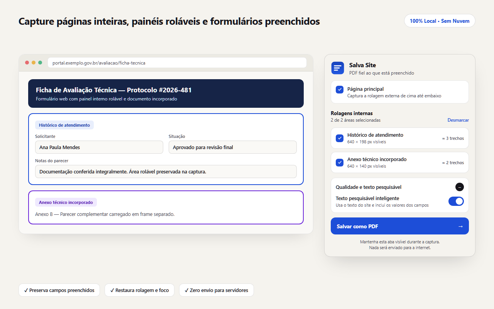
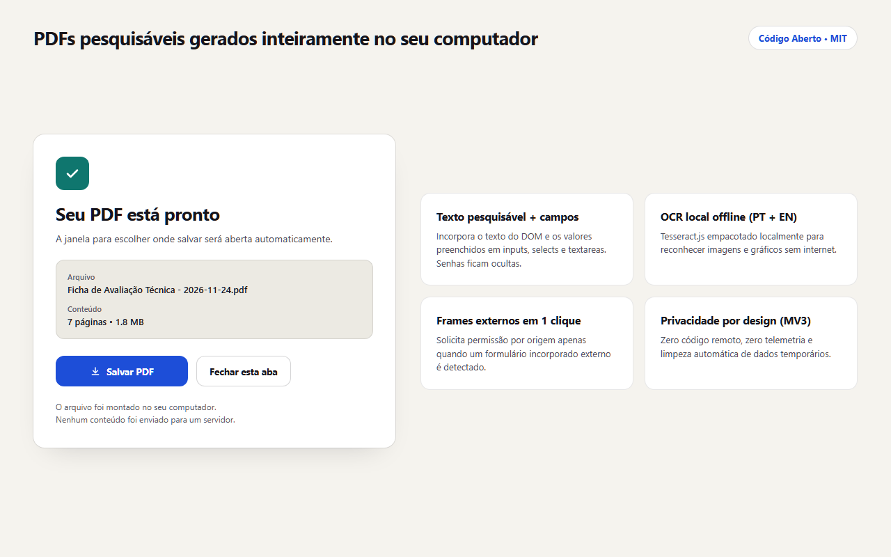

[English](README.md) | **Português (Brasil)**

# Salva Site

[](LICENSE)
[](src/manifest.json)
[](PRIVACY.md)
[](https://github.com/ricarossetto/salva-site/actions/workflows/ci.yml)

Capture páginas inteiras, painéis com rolagem interna, formulários incorporados de outros domínios e campos preenchidos em **PDFs pesquisáveis gerados localmente** — sem recarregar o site nem enviar dados para servidores.

---

## Por que usar o Salva Site?

O recurso nativo de imprimir para PDF e as extensões comuns de captura de tela falham em portais e sistemas web reais:

- **Áreas internas com barra de rolagem saem cortadas** (painéis laterais, blocos com `overflow-y: auto`, campos `<textarea>`).
- **Formulários dentro de `<embed>` ou `<iframe>` são cortados** no tamanho visível da caixa.
- **Recarregar a página apaga os campos preenchidos**, perdendo informações digitadas antes de salvar.
- **Capturas puras em imagem não permitem busca de texto** (`Ctrl+F`) sem OCR ou camada textual.

O Salva Site analisa a aba aberta sem recarregá-la, percorre a rolagem principal e cada rolagem interna selecionada, restaura a posição e o foco originais ao final e monta o PDF pesquisável inteiramente no seu computador.

---

## Capturas de tela





---

## Funcionalidades

- **Página principal + rolagens internas:** Detecta painéis roláveis e `<textarea>`, exibindo destaque visual na página ao passar o mouse ou navegar por teclado.
- **Suporte genérico a formulários incorporados (`<embed>` e `<iframe>`):** Captura frames da mesma origem automaticamente e detecta documentos externos oferecendo **autorização em 1 clique por origem**, sem pedir acesso amplo na instalação.
- **Preserva valores preenchidos:** Registra textos digitados em `<input>`, `<select>`, `<textarea>`, caixas de seleção e botões de opção na camada pesquisável.
- **Camada de texto pesquisável inteligente:** Incorpora o texto da página e dos campos com `pdf-lib`, `@pdf-lib/fontkit` e `Noto Sans` empacotados localmente.
- **OCR visual offline opcional (Português + Inglês):** Motor `tesseract.js` em WebAssembly incluído na extensão para reconhecer texto em imagens e `<canvas>` sem internet.
- **Cancelamento a qualquer momento:** O cartão de progresso na tela permite acompanhar o andamento e cancelar com um clique ou pressionando `Esc`, restaurando sempre a rolagem e o foco originais.
- **Tema claro e escuro automático:** Contraste acessível (WCAG AA), navegação completa por teclado e respeito a `prefers-reduced-motion`.
- **Multilíngue (`_locales`):** Disponível em Português (`pt_BR`, `pt`) e Inglês (`en`).

---

## Privacidade e Segurança

- **Zero envio pela rede:** Nenhuma captura, texto ou PDF sai do seu computador.
- **Zero código remoto:** Todas as bibliotecas de PDF, fontes e OCR rodam localmente dentro da extensão.
- **Proteção de senhas:** Campos `<input type="password">` permanecem mascarados visualmente e nunca são gravados na camada textual do PDF.
- **Limpeza automática:** Os PDFs temporários ficam no `IndexedDB` local apenas para abrir o diálogo de download e são removidos automaticamente após 24 horas.

Leia a [Política de Privacidade](PRIVACY.md) completa.

---

## Permissões explicadas

| Permissão | Finalidade |
| --- | --- |
| `activeTab` | Injeta o script de análise e captura quadros visíveis **somente** quando você aciona a extensão na aba ativa. |
| `scripting` | Executa `content.js` sob demanda na aba ativa e nos frames autorizados. |
| `webNavigation` | Lista os frames da aba ativa para identificar documentos incorporados roláveis. |
| `offscreen` | Executa o worker local de OCR em documento auxiliar apenas quando o OCR visual é ativado. |
| `storage` | Salva suas preferências locais do popup (texto pesquisável, OCR, qualidade). |
| `downloads` | Abre a janela **Salvar como** do navegador para o PDF gerado localmente. |
| `optional_host_permissions` (`https://*/*`, `http://*/*`) | Nunca concedida na instalação. Solicitada apenas quando você clica em **Permitir captura** para um domínio incorporado específico. |

---

## Instalação

### Opção 1: Release do GitHub (sem compactação)

1. Baixe o arquivo `salva-site-v0.3.1.zip` na página de [Releases](https://github.com/ricarossetto/salva-site/releases) e extraia a pasta.
2. Abra `brave://extensions` (ou `chrome://extensions` / `edge://extensions`).
3. Ative o **Modo do desenvolvedor**.
4. Clique em **Carregar sem compactação** e selecione a pasta extraída (que contém `manifest.json`).

### Opção 2: Compilar a partir do código-fonte

Requer **Node.js 20+**.

```bash
git clone https://github.com/ricarossetto/salva-site.git
cd salva-site
npm ci
npm run package
```

O comando monta a pasta `dist/`, executa todas as validações e gera `release/salva-site-v0.3.1.zip`.

---

## Créditos e Licença

- Distribuído sob a [Licença MIT](LICENSE).
- Bibliotecas locais: [pdf-lib](https://github.com/Hopding/pdf-lib), [@pdf-lib/fontkit](https://github.com/Hopding/fontkit), [tesseract.js](https://github.com/naptha/tesseract.js) e [Noto Sans](https://fonts.google.com/noto/specimen/Noto+Sans).
- Componentes interativos adaptados do [Lucian UX/UI Prompt](https://lucianlabs.dev/uxui-prompt/) sob licença MIT (`#004`, `#031`, `#044`, `#072`, `#433`, `#439`).

Veja [CONTRIBUTING.md](CONTRIBUTING.md) para contribuir.
